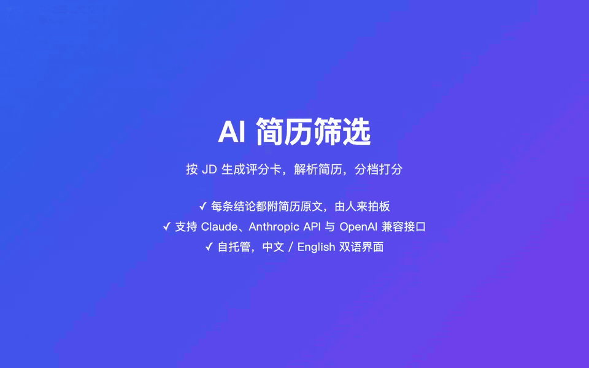
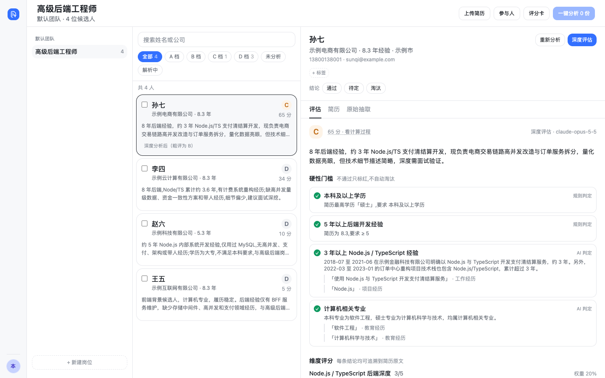
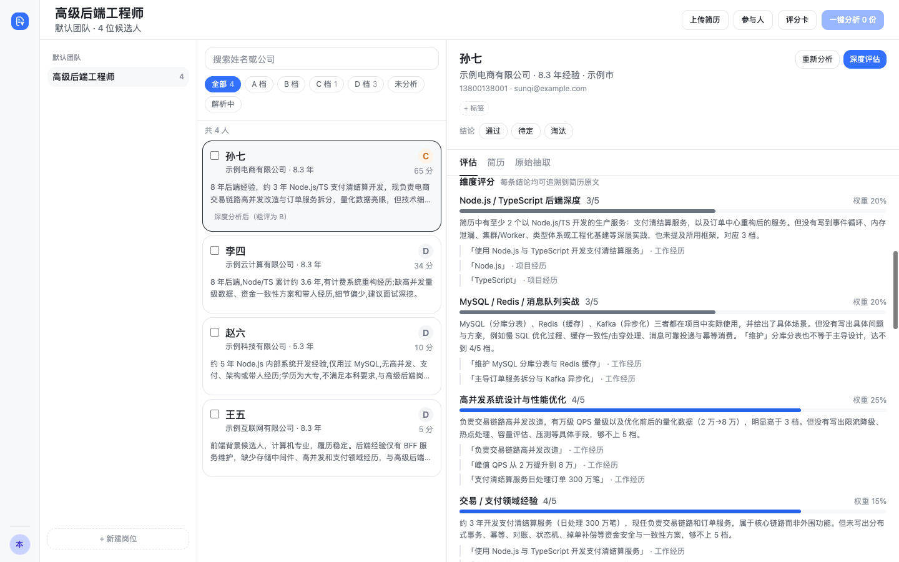
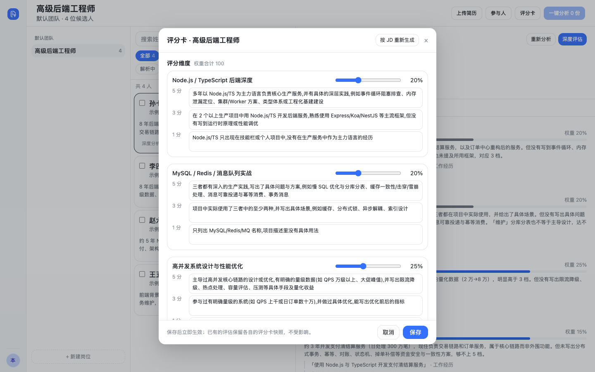

# ai-resume-screener

[English](README.md) | 中文

AI 简历筛选：按岗位 JD 生成评分卡，把各种格式的简历解析成结构化数据，再按评分卡分档打分；每条结论都附简历原文，最终由人来拍板。



▶ [观看高清演示视频（MP4，59 秒）](docs/media/demo-zh.mp4)

- **岗位管理**：团队、岗位与 JD；按岗位成员隔离查看权限
- **评分卡**：AI 根据 JD 生成评分卡草稿（维度、权重、5 / 3 / 1 分锚点、硬门槛），可人工调整，也可从其他岗位复制
- **简历解析**：支持 PDF、图片（png / jpg / webp）、docx、粘贴文本，可批量拖拽上传；PDF 先渲染成页图再交给视觉模型抽取结构化字段
- **派生字段**：工作年限、跳槽次数、空窗期、时间线冲突由规则计算，不交给模型
- **去重合并**：识别重复投递的同一候选人并合并记录
- **粗评与精评**：粗评批量输出 A / B / C / D 档位与总分；精评输出维度分、原文引用、亮点与存疑、面试提纲和同岗位横向排名
- **中英文界面**：默认跟随系统语言，也可以在左下角头像菜单里切换；AI 生成的评估结论、评分卡草稿按发起时的界面语言输出
- **多模型可切换**：解析、粗评、精评可分别配置模型，支持 Claude Code CLI、Anthropic API，以及豆包、千问、DeepSeek、智谱、Kimi、MiniMax、OpenAI 等 OpenAI 兼容接口（含 Ollama 等本地服务）
- **公平与可追溯**：硬门槛只标红不淘汰；评估前去掉姓名等字段，减少偏见；每条结论必须附简历原文
- **合规**：候选人彻底删除（原件、解析结果、评估一并删除）与操作审计日志
- **可选飞书通知**：批量解析或分析完成后，按发起人当时的界面语言推送飞书卡片

技术栈：Fastify + Prisma（SQLite）后端，React + Vite + Tailwind 前端，pnpm workspace 管理。

## 截图

岗位工作台：候选人按档位筛选，右侧是 AI 粗评结论与硬门槛判定。



精评：维度分、原文引用、亮点与存疑、面试追问。



评分卡：AI 根据 JD 生成草稿，可人工调整维度、权重、锚点与硬门槛。



截图中的候选人、公司与联系方式均为虚构，与 `pnpm demo` 造出的数据相同（见「快速开始」）。

## 外部依赖

| 程序 | 用途 | 安装 |
| --- | --- | --- |
| Node.js ≥ 20.19（推荐 22 或 24）、pnpm 9 | 运行与构建 | — |
| poppler（`pdfinfo`、`pdftocairo`） | 把 PDF 渲染成页图 | macOS `brew install poppler`；Debian `apt install poppler-utils` |
| 中文字体 | 服务器渲染中文 PDF，缺字体会渲染成方块 | Debian `apt install fonts-noto-cjk` |
| Claude Code CLI（`claude`） | 默认的模型通道；改用其他模型通道时不需要 | 按官方文档安装，并用运行服务的那个系统用户执行一次 `claude` 完成登录 |

api 启动时会检查 `pdfinfo`、`pdftocairo`（以及用到 Claude Code CLI 时的 `claude`）能否运行，并在日志里写明结果。缺 poppler 时只有 PDF 解析会失败，图片、docx、粘贴文本不受影响。

## 快速开始

```bash
pnpm install     # 安装依赖并生成 Prisma client
pnpm bootstrap   # 复制 api/.env.example → api/.env.dev，并创建本地 SQLite 数据库
pnpm dev         # 同时启动 api（:4070）和 web（:5070）
```

打开 <http://localhost:5070> 即可使用。默认是**本地单用户模式**：无需登录，唯一的本地用户就是超级管理员。首次启动会自动建一个「默认团队」。

默认通过本机的 Claude Code CLI 调用模型。没有 Claude 订阅时，在 `api/.env.dev` 里改用其他模型通道（见下节「模型配置」），重启 `pnpm dev` 即可。

想先看看效果？在 `pnpm dev` 运行时另开一个终端执行下面的命令，会建一个演示岗位，包含四份虚构简历、AI 生成的评分卡、粗评结果和一份精评（真实调用模型，需要几分钟）：

```bash
pnpm demo        # 跟随系统语言；也可以 pnpm demo zh / pnpm demo en
```

演示数据用你选的语言，AI 结论也是同一种语言。之后切换界面语言不会翻译已有的简历和评估，想两种都看就分别跑 `pnpm demo zh` 和 `pnpm demo en`。脚本只支持本地单用户模式。

上手顺序：新建岗位 → 配置评分卡（可让 AI 根据 JD 生成草稿）→ 上传简历（自动解析）→ 点「一键分析」做粗评 → 对感兴趣的候选人做精评。

上传的原件和渲染页图在 `api/data/`，数据库在 `api/prisma/dev.db`，两者都已被 git 忽略。

## 模型配置

解析、粗评、精评三档可以用不同的模型：`LLM_PROVIDER` / `LLM_MODEL` 对三档都生效，`LLM_PARSE_*`、`LLM_SCREEN_*`、`LLM_DEEP_*` 单独覆盖某一档。改完重启 api 生效，启动日志会逐档打印实际使用的通道和模型。通道名写错、缺 key 或缺模型名时 api 会拒绝启动，并列出全部问题。

| 通道（`LLM_PROVIDER`） | 需要的配置 | 说明 |
| --- | --- | --- |
| `claude`（默认） | 无 | 本机 Claude Code CLI。`LLM_MODEL` 可选（如 `opus`、`sonnet`），留空用 CLI 的默认模型 |
| `anthropic` | `ANTHROPIC_API_KEY` | Anthropic API，默认模型 `claude-opus-5-5`；`ANTHROPIC_BASE_URL` 可指向代理 |
| `openai` | `OPENAI_API_KEY`、模型名 | OpenAI API；`OPENAI_BASE_URL` 可指向任何 OpenAI 兼容服务（如 Ollama 的 `http://127.0.0.1:11434/v1`，此时 key 可不填） |
| `doubao` | `ARK_API_KEY`、模型名 | 火山方舟（豆包），在[方舟控制台 API Key 管理](https://console.volcengine.com/ark/region:ark+cn-beijing/apiKey)创建，说明见[管理 API Key](https://www.volcengine.com/docs/82379/1361424) |
| `qwen` | `QWEN_API_KEY`、模型名 | 阿里云百炼（千问），获取方式见[获取与配置 API Key](https://help.aliyun.com/zh/model-studio/get-api-key) |
| `deepseek` | `DEEPSEEK_API_KEY`、模型名 | DeepSeek，在 [API keys](https://platform.deepseek.com/api_keys) 页面创建 |
| `zhipu` | `ZHIPU_API_KEY`、模型名 | 智谱（GLM），在[智谱开放平台 API Keys](https://bigmodel.cn/usercenter/proj-mgmt/apikeys) 创建 |
| `kimi` | `KIMI_API_KEY`、模型名 | 月之暗面（Kimi），在 [Kimi 开放平台 API Keys](https://platform.moonshot.cn/console/api-keys) 创建 |
| `minimax` | `MINIMAX_API_KEY`、模型名 | MiniMax，在开放平台「账户管理 > 接口密钥」创建，见[如何获取 API Key](https://platform.minimaxi.com/docs/faq/about-apis) |

示例：解析用千问的视觉模型，粗评用 DeepSeek，精评用 Anthropic API。

```bash
LLM_PARSE_PROVIDER=qwen
LLM_PARSE_MODEL=qwen-vl-max
QWEN_API_KEY=...
LLM_SCREEN_PROVIDER=deepseek
LLM_SCREEN_MODEL=deepseek-chat
DEEPSEEK_API_KEY=...
LLM_DEEP_PROVIDER=anthropic
ANTHROPIC_API_KEY=...
```

注意事项：

- **解析 PDF 和图片需要支持图片输入的模型**。纯文本模型（如 DeepSeek 的对话模型）只能用于粗评、精评，或只解析 docx 和粘贴文本；具体哪些模型支持图片，以各家文档为准。
- 一份 PDF 最多渲染 `RESUME_MAX_PAGES` 页，每页一张图随请求发送。厂商对单次请求的图片数量或体积有上限时，调低 `RESUME_MAX_PAGES` 或 `RESUME_RENDER_LONG_EDGE`。
- `LLM_EFFORT`（`low` / `medium` / `high` / `xhigh` / `max`）只对 `claude` 和 `anthropic` 通道生效；精评固定使用 `high`。
- `ANTHROPIC_*` 环境变量也会传给 Claude Code CLI：配置了 `ANTHROPIC_API_KEY` 后，`claude` 通道同样会改用这个 key 计费。
- 简历解析出的字段保持简历原文的语言。AI 写的结论（摘要、亮点、存疑、面试追问）和评分卡草稿按发起分析的人当时的界面语言输出，并原样存库；之后切换界面语言不会翻译已有内容。原文引用始终是原文。

## 常用命令

| 命令 | 作用 |
| --- | --- |
| `pnpm dev` | 本地开发（web 通过 Vite 代理访问 api） |
| `pnpm build` | 构建 api（`api/dist`）和 web（`web/dist`） |
| `pnpm typecheck` | 全部包类型检查 |
| `pnpm test` | 全部单元测试（api 测试使用独立的 `api/prisma/test.db`） |
| `pnpm --filter @ai-resume-screener/api db:migrate` | 修改 `api/prisma/schema.prisma` 后生成并应用迁移 |
| `pnpm demo-video` | 重新录制 README 里的中英文演示（见下文） |

`api/scripts/` 下有几个开发脚本（用法写在各文件开头）：`parse-one.mts` 单独解析一份简历，`seed-demo.mts` 即上面的 `pnpm demo`（演示数据在 `demo-data.mts`），`eval-regress.mts` 改 prompt 后做评估回归对比（产出的 `eval-baseline.json` 含候选人姓名，已被 git 忽略）。

### 重新录制演示

`pnpm demo-video` 运行 [`scripts/demo-media.mjs`](scripts/demo-media.mjs)：按语言各启动一个真实 api（端口 4198，临时数据库在 `.tmp/demo-media/`），用 `pnpm demo` 造数据（虚构简历，真实调用模型，需要几分钟），在 4199 端口托管构建好的 web，再用 Playwright 驱动本机的 Google Chrome 录屏。产出 `docs/screenshots/{en,zh}/demo.gif` 和 `docs/media/demo-{en,zh}.mp4`。造好的数据库会存一份快照，再次录制不会重复调用模型；加 `--fresh` 重新造数据，加 `en` / `zh` 只录一种语言。

- 需要 `api/.env.dev` 里配好可用的模型通道、PATH 中有 `ffmpeg`，以及 Playwright 的录屏组件（`pnpm exec playwright install ffmpeg`）。
- 想用 Playwright 自带的 Chromium 代替 Chrome：执行 `pnpm exec playwright install chromium` 并设置 `PW_CHANNEL=`（留空）。

需要更多团队时，可以直接调接口：`curl -X POST http://127.0.0.1:4070/api/teams -H 'Content-Type: application/json' -d '{"name":"研发团队"}'`。

## 配置

api 用 Node 原生的 `--env-file` 加载配置：`pnpm dev` 读 `api/.env.dev`，`pnpm start` 读 `api/.env.prod`。两者都不入库，模板是 [`api/.env.example`](api/.env.example)，每项都有注释。模型相关的变量见上节。

| 变量 | 默认 | 说明 |
| --- | --- | --- |
| `DATABASE_URL` | — | SQLite 路径，相对路径以 `api/prisma/` 为基准；生产建议写绝对路径 |
| `DATA_DIR` | `./data` | 简历原件与渲染页图的目录（相对 `api/`） |
| `HOST` / `PORT` | `127.0.0.1` / `4070` | api 监听地址 |
| `TRUST_PROXY` | `loopback` | 信任的反向代理地址（Fastify `trustProxy`），限流按真实客户端 IP 分桶。同机 nginx 反代用默认值即可；不要设为 `true`，也不支持填跳数 |
| `WEB_ORIGIN` | `http://localhost:5070` | 前端访问地址，用于 CORS 白名单 |
| `CLAUDE_BIN` | 从 PATH 查找 | `claude` 可执行文件的路径 |
| `RESUME_MAX_PAGES` | `20` | 单份简历最多渲染的页数 |
| `LLM_IDLE_TIMEOUT_MS` / `LLM_HARD_TIMEOUT_MS` | `90000` / `600000` | 单次模型调用的空闲超时与总时长上限（毫秒，须为纯数字） |
| `WHOAMI_URL` | 未设置 | 设置后启用飞书登录，见下文 |
| `ADMIN_MOBILES` | 空 | 启用登录后的超级管理员手机号，逗号分隔 |
| `ALLOW_NO_AUTH` | `false` | 生产环境不配登录时 api 默认拒绝启动；确实要免登录运行时设为 `true` |
| `AUTH_API_BASE` / `INTERNAL_API_TOKEN` | 未设置 | 飞书通知，见下文 |
| `WEB_PUBLIC_URL` | `http://localhost:5070` | 用户实际访问本服务的地址，用于通知卡片里的链接 |

## 安全与隐私

简历含个人信息，部署前请读完这一节。

- **本地模式不鉴权**：能访问到 api 的人都能看到全部简历，所以 `HOST` 默认只监听本机，并且只接受 Host 为 `localhost` / `127.0.0.1` / `WEB_PUBLIC_URL` 主机名的请求，防止恶意网页通过 DNS rebinding 读取数据。`NODE_ENV=production` 且没配登录时 api 拒绝启动，除非显式设置 `ALLOW_NO_AUTH=true`。
- **简历会发给你选择的模型厂商**：解析时发送简历全文或页图，评估时发送去掉姓名等字段后的结构化内容。选择厂商前请确认其数据处理条款符合你的合规要求；对数据出境敏感时，可以用 `openai` 通道接本地部署的模型。
- **Claude Code CLI 通道与运维用户的配置隔离**：api 调用 `claude` 时固定使用 `dontAsk` 权限模式，只开放读取该份简历页图目录的 Read 工具，不加载用户的 settings、hooks、MCP、技能和 CLAUDE.md，也不保存会话记录（在 Claude Code 2.1.318 上验证，升级 CLI 后建议复核）。子进程只继承运行所需的环境变量，不含 `INTERNAL_API_TOKEN` 等密钥。因为不读 settings，如果你在 `~/.claude/settings.json` 里通过 `env` 配置了代理或中转地址，需要改成写在 `api/.env.*` 里的环境变量（`ANTHROPIC_BASE_URL`、`HTTPS_PROXY` 等）。
- **静态存储是明文**：简历原件和数据库里的解析结果没有加密（联系方式的去重哈希也只是未加盐的 SHA-256，不能当作脱敏），请用磁盘加密和目录权限保护 `DATA_DIR` 与数据库文件。
- **彻底删除的范围**：删除候选人会删掉原件、页图、解析结果、评估，并清空合并记录里的自由文本备注；SQLite 开启了 `secure_delete`，被删内容不会残留在库文件空闲页里。审计日志有意保留操作对象的姓名快照，用于事后追溯。删除不会追溯历史备份：如果你定期备份数据库和 `DATA_DIR`，备份里的副本会保留到备份过期为止。删除岗位时，只属于该岗位的原件、页图和候选人会一并清理。

## 可选：飞书登录与权限

不设置时为本地单用户模式。需要多人使用时，接入同系列开源项目 [feishu-sso](https://github.com/AI-Pocket-Verse/feishu-sso)（飞书统一登录服务）。先按它的 README 部署好，再做下面几步：

1. 让 feishu-sso 与本服务同域名（登录 cookie 依赖同源）：把它的 nginx 片段（feishu-sso 仓库的 `deploy/nginx-locations.conf.template`）用 `include /etc/nginx/snippets/feishu-sso.conf;` 加进本站的 `server { }`。本仓库的 `deploy/nginx.conf.template` 里已经留好这一行，取消注释即可。
2. api 设置 `WHOAMI_URL`，指向 feishu-sso 的 whoami 接口，例如 `http://127.0.0.1:4020/api/whoami`。
3. web 构建时设置 `VITE_SSO_BASE=/auth`（可写在 `web/.env.local`）。
4. api 设置 `ADMIN_MOBILES`，填超级管理员的手机号（多个用逗号分隔，`+86` 等前缀会自动去掉）。飞书应用需要有读取手机号的权限，否则谁都不会被识别为超管。

本地开发时，feishu-sso 也用 `pnpm dev` 启动（监听 :4020 / :5020），本项目在 `web/.env.local` 写 `VITE_SSO_BASE=http://localhost:5020/auth`，并把 `http://localhost:5070` 加进 feishu-sso 的 `CORS_ORIGINS`。

接入后的权限：

| 角色 | 能做什么 |
| --- | --- |
| 登录用户 | 创建岗位（自己成为该岗位 owner）；只能看到自己参与的岗位及其候选人 |
| 岗位成员（含 owner） | 在该岗位内上传简历、查看候选人与评估，**编辑岗位信息和评分卡**（包括保存、复制评分卡） |
| 岗位 owner | 在成员能力之上，添加 / 移除岗位成员、删除岗位 |
| 超级管理员 | 看到全部岗位；彻底删除候选人；查看审计日志 |

同一个人投递多个岗位时会合并为一个候选人，但你只能看到自己可见岗位里那几份简历上的姓名和联系方式。引用其他岗位的候选人或评分卡（挂靠候选人、复制评分卡）要求对方岗位对你可见，否则按「不存在」处理。查看联系方式、合并、删除、修改岗位信息、保存 / 复制评分卡、删除岗位、增删岗位成员都会写入审计日志（修改岗位只记录被改的字段名，不记内容）。

## 可选：飞书通知

批量解析或分析完成后，给发起人推送一张飞书卡片，文案用发起时的界面语言。本服务不持有飞书凭证，通知通过 feishu-sso 发送，因此需要先完成上面的飞书登录：

1. api 设置 `AUTH_API_BASE`，指向 feishu-sso 的 API 地址，例如 `http://127.0.0.1:4020/api`。要在本机直连，不要经过域名：通知接口不对外开放。
2. api 设置 `INTERNAL_API_TOKEN`，值必须与 feishu-sso 配置中的 `INTERNAL_API_TOKEN` 完全相同。
3. api 设置 `WEB_PUBLIC_URL` 为用户实际访问本服务的地址，卡片里的按钮会打开它。
4. 飞书应用需要开启机器人能力和 `im:message:send_as_bot` 权限（见 feishu-sso 的 README）。

两项都不设置时不发通知，启动日志会显示 `feishu notify: off`。生产环境配置了 `AUTH_API_BASE` 但口令为空或仍是占位符时，api 会拒绝启动，避免通知悄悄失效。

## 部署

`deploy/` 提供 systemd 与 nginx 模板（单机部署，nginx 托管前端静态文件并反代 api，强制 HTTPS 并带安全响应头）：

```bash
git clone <repo> /opt/ai-resume-screener && cd /opt/ai-resume-screener
pnpm install && pnpm build
cp api/.env.example api/.env.prod   # 改为 NODE_ENV=production，DATABASE_URL / DATA_DIR 用绝对路径，配置模型、登录与通知
pnpm --filter @ai-resume-screener/api db:migrate:prod

sudo cp deploy/systemd.service.template /etc/systemd/system/ai-resume-screener.service
sudo sed -i 's|__INSTALL_DIR__|/opt/ai-resume-screener|; s|__SERVICE_USER__|resume|' /etc/systemd/system/ai-resume-screener.service
sudo systemctl daemon-reload && sudo systemctl enable --now ai-resume-screener

sudo cp deploy/nginx.conf.template /etc/nginx/sites-available/ai-resume-screener
sudo sed -i 's|__INSTALL_DIR__|/opt/ai-resume-screener|; s|__SERVER_NAME__|resume.example.com|; s|__SSL_CERT__|/etc/letsencrypt/live/resume.example.com/fullchain.pem|; s|__SSL_KEY__|/etc/letsencrypt/live/resume.example.com/privkey.pem|' /etc/nginx/sites-available/ai-resume-screener
sudo ln -sf /etc/nginx/sites-available/ai-resume-screener /etc/nginx/sites-enabled/ && sudo nginx -t && sudo systemctl reload nginx
```

证书路径按你的签发方式填写（上例是 certbot 的默认位置）。生产环境需要配置飞书登录（`WHOAMI_URL`），否则 api 拒绝启动。

nginx 模板把 `X-Forwarded-For` 设为 `$remote_addr`（覆盖而不是追加），配合默认的 `TRUST_PROXY=loopback`，客户端无法伪造来源 IP 绕过限流；api 不在本机时把 `TRUST_PROXY` 改成实际代理地址。

运行服务的系统用户（上例为 `resume`）需要能执行 `pdfinfo` 和 `pdftocairo`；用到 `claude` 通道时，还要能执行 `claude`，并且用该用户登录过一次。

## 目录结构

```
api/        Fastify 后端：上传、解析队列、评估队列、去重、合规、飞书通知
web/        React 前端（界面文案在 web/src/i18n/）
shared/     api 与 web 共用的 zod schema（简历结构、评分卡、评估输出）
packages/   共用小包（LLM 调用层、登录客户端、皮肤 token、Tailwind 预设等）
deploy/     systemd / nginx 模板
```

## License

[MIT](LICENSE)
