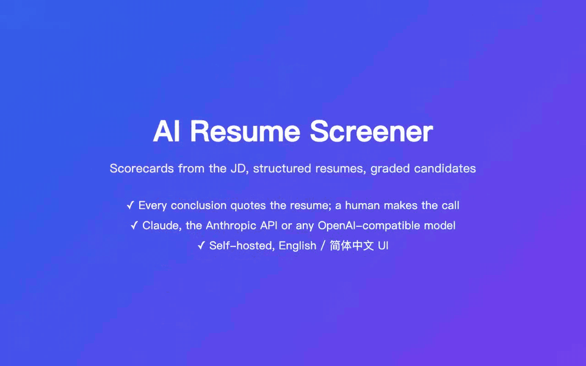
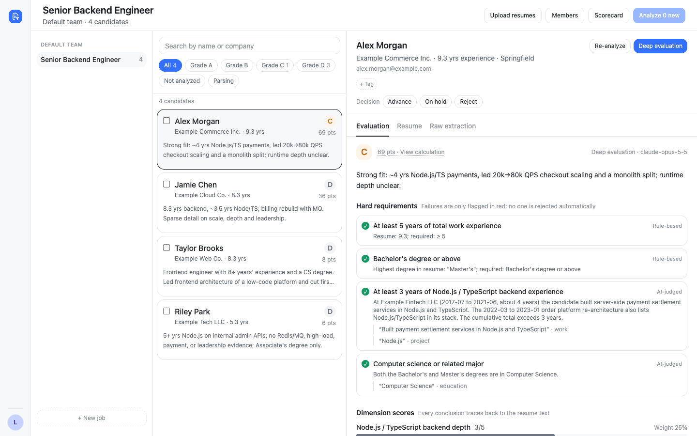
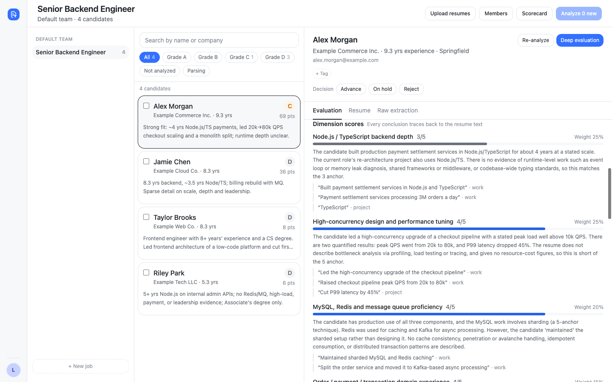
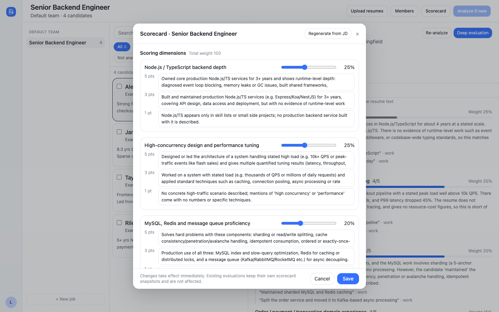

# ai-resume-screener

English | [中文](README-CN.md)

AI resume screening: generate a scorecard from a job description, parse resumes in any common format into structured data, then grade them against the scorecard. Every conclusion quotes the resume verbatim, and a human makes the final call.



▶ [Watch the full-quality demo video (MP4, 59 s)](docs/media/demo-en.mp4)

- **Jobs**: teams, jobs and JDs; visibility is isolated by job membership
- **Scorecards**: AI drafts a scorecard from the JD (dimensions, weights, 5 / 3 / 1 anchors, hard requirements); edit it by hand or copy one from another job
- **Resume parsing**: PDF, images (png / jpg / webp), docx and pasted text, with drag-and-drop batch upload; PDFs are rendered to page images and read by a vision model
- **Derived fields**: years of experience, job changes, employment gaps and timeline conflicts are computed by rules, not by the model
- **Deduplication**: recognizes the same candidate applying more than once and merges the records
- **Screening and deep evaluation**: screening grades a batch into A / B / C / D with a total score; deep evaluation adds per-dimension scores, quotes, highlights and concerns, interview questions and a ranking against other candidates for the same job
- **English and Chinese UI**: follows the system language by default and can be switched from the avatar menu in the bottom-left corner; AI-written conclusions and scorecard drafts use the UI language of whoever started the analysis
- **Switchable models**: parsing, screening and deep evaluation can each use a different model -- Claude Code CLI, the Anthropic API, or any OpenAI-compatible API (Doubao, Qwen, DeepSeek, Zhipu GLM, Kimi, MiniMax, OpenAI, and local servers such as Ollama)
- **Fair and traceable**: hard requirements are flagged, never used to auto-reject; names and similar fields are removed before evaluation to reduce bias; every conclusion must quote the resume
- **Compliance**: permanent candidate deletion (originals, parsed data and evaluations) and an audit log
- **Optional Feishu (Lark) notifications**: a card is sent to the person who started a parsing or analysis batch when it finishes, in the UI language they were using

Stack: Fastify + Prisma (SQLite) backend, React + Vite + Tailwind frontend, managed as a pnpm workspace.

## Screenshots

Job workspace: filter candidates by grade; the right panel shows the AI screening result and the hard-requirement checks.



Deep evaluation: per-dimension scores, verbatim quotes, highlights and concerns, and interview questions.



Scorecard: AI drafts it from the JD; adjust dimensions, weights, anchors and hard requirements by hand.



All candidates, companies and contact details in the screenshots are fictional -- the same data `pnpm demo` creates (see Quick start).

## Requirements

| Program | Purpose | Install |
| --- | --- | --- |
| Node.js ≥ 20.19 (22 or 24 recommended), pnpm 9 | Run and build | — |
| poppler (`pdfinfo`, `pdftocairo`) | Render PDFs to page images | macOS `brew install poppler`; Debian `apt install poppler-utils` |
| CJK fonts | Needed on servers to render Chinese PDFs; without them characters show up as boxes | Debian `apt install fonts-noto-cjk` |
| Claude Code CLI (`claude`) | The default model provider; not needed if you use another provider | Install it following the official docs, then run `claude` once as the user that runs the service to log in |

On startup the api checks that `pdfinfo`, `pdftocairo` (and `claude`, when the Claude Code CLI provider is used) can run, and logs the result. Without poppler only PDF parsing fails; images, docx and pasted text still work.

## Quick start

```bash
pnpm install     # install dependencies and generate the Prisma client
pnpm bootstrap   # copy api/.env.example to api/.env.dev and create the local SQLite database
pnpm dev         # start the api (:4070) and the web app (:5070)
```

Open <http://localhost:5070>. By default the app runs in **local single-user mode**: no login, and the only local user is the super admin. A "Default team" is created on first start.

Models are called through the Claude Code CLI on this machine by default. Without a Claude subscription, switch to another provider in `api/.env.dev` (see "Model configuration" below) and restart `pnpm dev`.

Want to look around first? With `pnpm dev` running, run this in another terminal to create a demo job with four fictional resumes, an AI-drafted scorecard, screening results and one deep evaluation (it calls the model for real and takes a few minutes):

```bash
pnpm demo        # follows the system language; or pnpm demo en / pnpm demo zh
```

The demo data is written in the language you choose, and so are the AI conclusions. Switching the UI language later does not translate existing resumes or evaluations, so run `pnpm demo en` and `pnpm demo zh` if you want both. The script only works in local single-user mode.

Getting started: create a job → set up the scorecard (AI can draft it from the JD) → upload resumes (parsed automatically) → click "Analyze N new" to screen them → run a deep evaluation on the candidates you are interested in.

Uploaded originals and rendered page images are stored in `api/data/`, and the database in `api/prisma/dev.db`. Both are ignored by git.

## Model configuration

Parsing, screening and deep evaluation can use different models. `LLM_PROVIDER` / `LLM_MODEL` apply to all three; `LLM_PARSE_*`, `LLM_SCREEN_*` and `LLM_DEEP_*` override one purpose. Restart the api after a change; the startup log prints the provider and model used for each purpose. If a provider name is wrong, or a key or model name is missing, the api refuses to start and lists every problem.

| Provider (`LLM_PROVIDER`) | Required settings | Notes |
| --- | --- | --- |
| `claude` (default) | none | Claude Code CLI on this machine. `LLM_MODEL` is optional (e.g. `opus`, `sonnet`); empty uses the CLI's default model |
| `anthropic` | `ANTHROPIC_API_KEY` | Anthropic API, default model `claude-opus-5-5`; `ANTHROPIC_BASE_URL` can point to a proxy |
| `openai` | `OPENAI_API_KEY`, model name | OpenAI API; `OPENAI_BASE_URL` can point to any OpenAI-compatible server (e.g. Ollama at `http://127.0.0.1:11434/v1`, where the key can be left empty) |
| `doubao` | `ARK_API_KEY`, model name | Volcano Engine Ark (Doubao). Create a key in the [Ark console](https://console.volcengine.com/ark/region:ark+cn-beijing/apiKey); see [Manage API keys](https://www.volcengine.com/docs/82379/1361424) |
| `qwen` | `QWEN_API_KEY`, model name | Alibaba Cloud Model Studio (Qwen). See [Get an API key](https://help.aliyun.com/zh/model-studio/get-api-key) |
| `deepseek` | `DEEPSEEK_API_KEY`, model name | DeepSeek. Create a key on the [API keys](https://platform.deepseek.com/api_keys) page |
| `zhipu` | `ZHIPU_API_KEY`, model name | Zhipu (GLM). Create a key in the [Zhipu console](https://bigmodel.cn/usercenter/proj-mgmt/apikeys) |
| `kimi` | `KIMI_API_KEY`, model name | Moonshot (Kimi). Create a key in the [Kimi console](https://platform.moonshot.cn/console/api-keys) |
| `minimax` | `MINIMAX_API_KEY`, model name | MiniMax. Create a key under "Account > API keys"; see [How to get an API key](https://platform.minimaxi.com/docs/faq/about-apis) |

Example: a Qwen vision model for parsing, DeepSeek for screening, and the Anthropic API for deep evaluation.

```bash
LLM_PARSE_PROVIDER=qwen
LLM_PARSE_MODEL=qwen-vl-max
QWEN_API_KEY=...
LLM_SCREEN_PROVIDER=deepseek
LLM_SCREEN_MODEL=deepseek-chat
DEEPSEEK_API_KEY=...
LLM_DEEP_PROVIDER=anthropic
ANTHROPIC_API_KEY=...
```

Notes:

- **Parsing PDFs and images needs a model that accepts images.** Text-only models (such as DeepSeek's chat model) can only be used for screening and deep evaluation, or for parsing docx and pasted text. Check each vendor's docs for which models accept images.
- A PDF is rendered to at most `RESUME_MAX_PAGES` pages, one image per page in the request. If a vendor limits the number or size of images per request, lower `RESUME_MAX_PAGES` or `RESUME_RENDER_LONG_EDGE`.
- `LLM_EFFORT` (`low` / `medium` / `high` / `xhigh` / `max`) only applies to the `claude` and `anthropic` providers; deep evaluation always uses `high`.
- `ANTHROPIC_*` environment variables are also passed to the Claude Code CLI: once `ANTHROPIC_API_KEY` is set, the `claude` provider bills that key as well.
- Parsed resume fields keep the resume's own language. AI-written conclusions (summaries, highlights, concerns, interview questions) and scorecard drafts are written in the UI language of whoever started the analysis and are stored as is; switching the UI language later does not translate them. Quotes are always verbatim.

## Commands

| Command | Purpose |
| --- | --- |
| `pnpm dev` | Local development (the web app reaches the api through the Vite proxy) |
| `pnpm build` | Build the api (`api/dist`) and the web app (`web/dist`) |
| `pnpm typecheck` | Type-check all packages |
| `pnpm test` | Run all unit tests (api tests use a separate `api/prisma/test.db`) |
| `pnpm --filter @ai-resume-screener/api db:migrate` | Create and apply a migration after changing `api/prisma/schema.prisma` |
| `pnpm demo-video` | Re-record the README demo in both languages (see below) |

`api/scripts/` has a few development scripts (usage at the top of each file): `parse-one.mts` parses a single resume, `seed-demo.mts` is the `pnpm demo` script above (demo data in `demo-data.mts`), and `eval-regress.mts` compares evaluations after a prompt change (its `eval-baseline.json` output contains candidate names and is ignored by git).

### Re-recording the demo

`pnpm demo-video` runs [`scripts/demo-media.mjs`](scripts/demo-media.mjs). For each language it starts the real api on port 4198 with a throwaway database under `.tmp/demo-media/`, fills it with `pnpm demo` data (fictional resumes, real model calls, a few minutes), serves the built web app on port 4199 and drives the locally installed Google Chrome with Playwright. Output: `docs/screenshots/{en,zh}/demo.gif` and `docs/media/demo-{en,zh}.mp4`. The seeded database is kept as a snapshot, so re-recording does not call the model again; pass `--fresh` to re-seed, or `en` / `zh` to record one language.

- Needs a working model channel in `api/.env.dev`, `ffmpeg` on your PATH and Playwright's recorder (`pnpm exec playwright install ffmpeg`).
- To use Playwright's bundled Chromium instead of Chrome, run `pnpm exec playwright install chromium` and set `PW_CHANNEL=` (empty).

To add more teams, call the API directly: `curl -X POST http://127.0.0.1:4070/api/teams -H 'Content-Type: application/json' -d '{"name":"Engineering"}'`.

## Configuration

The api loads its settings with Node's built-in `--env-file`: `pnpm dev` reads `api/.env.dev` and `pnpm start` reads `api/.env.prod`. Neither is committed; the template is [`api/.env.example`](api/.env.example), with a comment on every setting. Model settings are described above.

| Variable | Default | Description |
| --- | --- | --- |
| `DATABASE_URL` | — | SQLite path; relative paths are resolved against `api/prisma/`. Use an absolute path in production |
| `DATA_DIR` | `./data` | Directory for original resumes and rendered page images (relative to `api/`) |
| `HOST` / `PORT` | `127.0.0.1` / `4070` | Address the api listens on |
| `TRUST_PROXY` | `loopback` | Trusted reverse proxies (Fastify `trustProxy`), so rate limiting uses the real client IP. Keep the default for nginx on the same host; do not set it to `true`, and hop counts are not supported |
| `WEB_ORIGIN` | `http://localhost:5070` | Origin of the web app, for the CORS allowlist |
| `CLAUDE_BIN` | found on PATH | Path to the `claude` executable |
| `RESUME_MAX_PAGES` | `20` | Maximum number of pages rendered per resume |
| `LLM_IDLE_TIMEOUT_MS` / `LLM_HARD_TIMEOUT_MS` | `90000` / `600000` | Idle timeout and total time limit for one model call (milliseconds, plain numbers only) |
| `WHOAMI_URL` | unset | Enables Feishu login when set; see below |
| `ADMIN_MOBILES` | empty | Super admin mobile numbers once login is enabled, comma-separated |
| `ALLOW_NO_AUTH` | `false` | Without login the api refuses to start in production; set to `true` only if you really want to run without login |
| `AUTH_API_BASE` / `INTERNAL_API_TOKEN` | unset | Feishu notifications; see below |
| `WEB_PUBLIC_URL` | `http://localhost:5070` | The address users actually open, used for links in notification cards |

## Security and privacy

Resumes contain personal data. Read this section before deploying.

- **Local mode has no authentication**: anyone who can reach the api can see every resume. That is why `HOST` only listens on the local machine by default, and only requests whose Host is `localhost` / `127.0.0.1` / the host of `WEB_PUBLIC_URL` are accepted, which stops malicious pages from reading data through DNS rebinding. With `NODE_ENV=production` and no login configured, the api refuses to start unless `ALLOW_NO_AUTH=true` is set explicitly.
- **Resumes are sent to the model vendor you choose**: parsing sends the full resume text or page images, and evaluation sends the structured data with names and similar fields removed. Before choosing a vendor, make sure its data-processing terms meet your compliance requirements. If data leaving your network is a concern, use the `openai` provider with a locally hosted model.
- **The Claude Code CLI provider is isolated from the operator's own configuration**: the api always calls `claude` in `dontAsk` permission mode, with only a Read tool limited to that resume's page-image directory. It does not load the user's settings, hooks, MCP servers, skills or CLAUDE.md, and does not save session transcripts (verified on Claude Code 2.1.318; re-check after upgrading the CLI). The child process only inherits the environment variables it needs, never secrets such as `INTERNAL_API_TOKEN`. Because settings are not loaded, a proxy or relay configured through `env` in `~/.claude/settings.json` must be moved to environment variables in `api/.env.*` (`ANTHROPIC_BASE_URL`, `HTTPS_PROXY`, and so on).
- **Data at rest is not encrypted**: original resumes and parsed data in the database are stored in plain text (the contact-detail hashes used for deduplication are unsalted SHA-256 and are not anonymization). Protect `DATA_DIR` and the database file with disk encryption and directory permissions.
- **What permanent deletion covers**: deleting a candidate removes the originals, page images, parsed data and evaluations, and clears free-text notes in merge records; SQLite runs with `secure_delete`, so deleted content does not linger in free pages of the database file. The audit log deliberately keeps a snapshot of the target's name for later review. Deletion does not reach backups: if you back up the database and `DATA_DIR`, copies stay in the backups until they expire. Deleting a job also removes originals, page images and candidates that belong only to that job.

## Optional: Feishu login and permissions

Without it the app runs in local single-user mode. For multiple users, connect [feishu-sso](https://github.com/AI-Pocket-Verse/feishu-sso), an open-source Feishu (Lark) single sign-on service from the same series. Set it up by following its README first, then:

1. Serve feishu-sso on the same domain as this app (the login cookie relies on it): add its nginx snippet (`deploy/nginx-locations.conf.template` in the feishu-sso repo) to this site's `server { }` block with `include /etc/nginx/snippets/feishu-sso.conf;`. The line is already in this repo's `deploy/nginx.conf.template`, commented out.
2. Set `WHOAMI_URL` on the api to feishu-sso's whoami endpoint, e.g. `http://127.0.0.1:4020/api/whoami`.
3. Build the web app with `VITE_SSO_BASE=/auth` (can be put in `web/.env.local`).
4. Set `ADMIN_MOBILES` on the api to the super admins' mobile numbers (comma-separated; prefixes such as `+86` are stripped). The Feishu app needs permission to read mobile numbers, otherwise nobody is recognized as a super admin.

For local development, start feishu-sso with `pnpm dev` as well (it listens on :4020 / :5020), set `VITE_SSO_BASE=http://localhost:5020/auth` in `web/.env.local`, and add `http://localhost:5070` to feishu-sso's `CORS_ORIGINS`.

Permissions once login is enabled:

| Role | Can do |
| --- | --- |
| Signed-in user | Create jobs (becoming that job's owner); sees only the jobs they belong to and their candidates |
| Job member (including the owner) | Upload resumes in that job, view candidates and evaluations, **edit the job and its scorecard** (including saving and copying scorecards) |
| Job owner | On top of member rights, add / remove job members and delete the job |
| Super admin | Sees every job; permanently deletes candidates; reads the audit log |

When the same person applies to several jobs, the applications are merged into one candidate, but you only see the names and contact details from resumes in the jobs visible to you. Referencing another job's candidate or scorecard (attaching a candidate, copying a scorecard) requires that job to be visible to you; otherwise it is treated as not found. Viewing contact details, merging, deleting, editing a job, saving / copying a scorecard, deleting a job and adding / removing job members are all written to the audit log (job edits only record which fields changed, not their content).

## Optional: Feishu notifications

When a parsing or analysis batch finishes, a Feishu card is sent to the person who started it, written in the UI language they were using at the time. This service holds no Feishu credentials; notifications go through feishu-sso, so set up Feishu login first:

1. Set `AUTH_API_BASE` on the api to feishu-sso's API base, e.g. `http://127.0.0.1:4020/api`. Call it directly on the same machine, not through the domain: the notification endpoints are not exposed publicly.
2. Set `INTERNAL_API_TOKEN` on the api to exactly the same value as `INTERNAL_API_TOKEN` in feishu-sso's configuration.
3. Set `WEB_PUBLIC_URL` to the address users actually open; the button in the card links there.
4. The Feishu app needs the bot capability and the `im:message:send_as_bot` scope (see feishu-sso's README).

With neither set, no notifications are sent and the startup log shows `feishu notify: off`. In production, if `AUTH_API_BASE` is set but the token is empty or still a placeholder, the api refuses to start so that notifications do not silently fail.

## Deployment

`deploy/` contains systemd and nginx templates (single-host deployment: nginx serves the built frontend and proxies the api, forces HTTPS and adds security headers):

```bash
git clone <repo> /opt/ai-resume-screener && cd /opt/ai-resume-screener
pnpm install && pnpm build
cp api/.env.example api/.env.prod   # set NODE_ENV=production, absolute DATABASE_URL / DATA_DIR, and configure models, login and notifications
pnpm --filter @ai-resume-screener/api db:migrate:prod

sudo cp deploy/systemd.service.template /etc/systemd/system/ai-resume-screener.service
sudo sed -i 's|__INSTALL_DIR__|/opt/ai-resume-screener|; s|__SERVICE_USER__|resume|' /etc/systemd/system/ai-resume-screener.service
sudo systemctl daemon-reload && sudo systemctl enable --now ai-resume-screener

sudo cp deploy/nginx.conf.template /etc/nginx/sites-available/ai-resume-screener
sudo sed -i 's|__INSTALL_DIR__|/opt/ai-resume-screener|; s|__SERVER_NAME__|resume.example.com|; s|__SSL_CERT__|/etc/letsencrypt/live/resume.example.com/fullchain.pem|; s|__SSL_KEY__|/etc/letsencrypt/live/resume.example.com/privkey.pem|' /etc/nginx/sites-available/ai-resume-screener
sudo ln -sf /etc/nginx/sites-available/ai-resume-screener /etc/nginx/sites-enabled/ && sudo nginx -t && sudo systemctl reload nginx
```

Fill in the certificate paths according to how you issue certificates (the example uses certbot's default location). Production requires Feishu login (`WHOAMI_URL`); otherwise the api refuses to start.

The nginx template sets `X-Forwarded-For` to `$remote_addr` (overwriting rather than appending). Combined with the default `TRUST_PROXY=loopback`, clients cannot spoof their IP to get around rate limiting. If the api is not on the same host, set `TRUST_PROXY` to the actual proxy address.

The service user (`resume` in the example) must be able to run `pdfinfo` and `pdftocairo`; when the `claude` provider is used, it must also be able to run `claude` and must have logged in once as that user.

## Project layout

```
api/        Fastify backend: uploads, parse queue, evaluation queue, deduplication, compliance, Feishu notifications
web/        React frontend (UI strings in web/src/i18n/)
shared/     zod schemas shared by api and web (resume structure, scorecard, evaluation output)
packages/   small shared packages (LLM layer, login client, theme tokens, Tailwind preset, ...)
deploy/     systemd / nginx templates
```

## License

[MIT](LICENSE)
